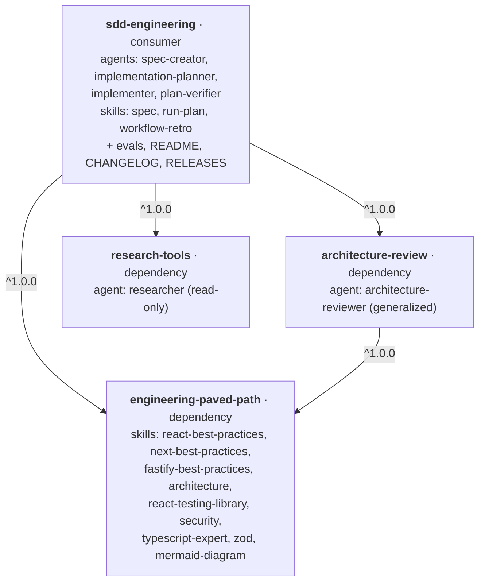
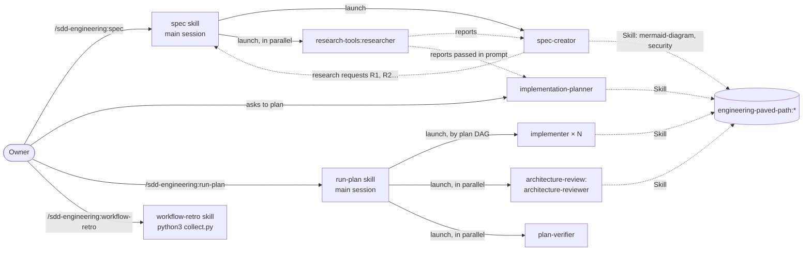

# Dependency graph

How the four plugins from [PLUGINS-SPEC.md](PLUGINS-SPEC.md) depend on each other, how they call each other at runtime, and in which order we build and release them. Mermaid renders on GitHub and in IDE previews.

## 1. Install time: who depends on whom

Declared in each plugin's `plugin.json` under `dependencies`. Installing a plugin installs everything it depends on.

| Plugin | Depends on | Why |
| :- | :- | :- |
| `engineering-paved-path` | — | Only skills; no agents to call |
| `research-tools` | — | `researcher` is self-contained (repo + web research) |
| `architecture-review` | `engineering-paved-path ^1.0.0` | `architecture-reviewer` preloads `engineering-paved-path:architecture`; without it, a standalone install reviews with no architecture rules |
| `sdd-engineering` | all three, `^1.0.0` | Its workflow launches `researcher` and `architecture-reviewer` and points every plan step at a paved-path skill |

The graph is acyclic. Database skills (`drizzle-orm-patterns`, `postgresql-table-design`) are not part of 1.0.0; they will come as a separate `data-paved-path` plugin.

## 2. Runtime: who calls whom

Agents never launch other agents: none of them has the `Agent` tool. The **main session** launches every agent, driven by the two orchestrating skills `spec` and `run-plan`. Agents and skills load paved-path skills with the `Skill` tool. Everything from another plugin is called by namespace.

Solid arrows launch something; dashed arrows pass results or load a skill.

| Step | Who starts it | Launches / loads | Cross-plugin names |
| :- | :- | :- | :- |
| Spec | Owner: `/sdd-engineering:spec` | `spec-creator`, then `researcher` for each research request, in parallel | `research-tools:researcher` |
| Plan | Owner, on an approved spec | `implementation-planner`; researcher reports are pasted into its prompt | `engineering-paved-path:*` (skill per step) |
| Implement | Owner: `/sdd-engineering:run-plan` | `implementer` lanes along the plan's DAG | `engineering-paved-path:*` |
| Review gate | `run-plan`, after all lanes finish | `architecture-reviewer` ‖ `plan-verifier` in parallel, then a bounded fix cycle | `architecture-review:architecture-reviewer` |
| Retro | Owner: `/sdd-engineering:workflow-retro` | `python3 "${CLAUDE_SKILL_DIR}/scripts/collect.py"` over session transcripts | — |

`run-plan` must pass `subagent_type` with the full namespace (`architecture-review:architecture-reviewer`, `sdd-engineering:implementer`), because other plugins may ship agents with the same short name.

## 3. Build and release order

Dependencies first, so every `^1.0.0` range resolves against an existing `<plugin>--v1.0.0` tag.

| # | Plugin | Effort | Notes |
| :- | :- | :- | :- |
| 1 | `engineering-paved-path` | Low–medium | Copy skills; generalize `onion-architecture` + `frontend-ui-architecture` into `architecture` |
| 2 | `research-tools` | Low | `researcher` nearly as is; drop DevDigest paths and `investigator` links |
| 3 | `architecture-review` | Medium | Generalize `architecture-reviewer`; depends on step 1 |
| 4 | `sdd-engineering` | High | Four agents and three skills; namespace every cross-plugin call; evals; README, CHANGELOG, RELEASES |

Steps 2 and 3 can run in parallel once step 1 is merged. Each step is its own PR; `release-tags.yml` creates the tag after merge.
