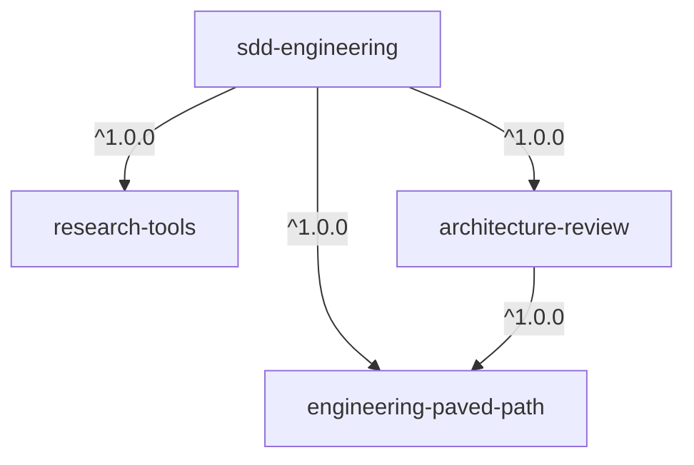
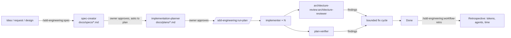

# Plugin structure spec: SDD Engineering and its dependencies

Status: approved 2026-10-26 (see [Decisions](#decisions)). Covers lab steps 2–7: which components we ship, how they split into plugins, the dependency graph, packaging rules, validation and the 1.0.0 release.

Source of all components: `main` of [OlegDEma/dev-digest](https://github.com/OlegDEma/dev-digest) at commit `cc5910ee` (merge of PR #12, branch `LO5`), folders `.claude/agents/` and `.claude/skills/`. Pin this commit when copying, so later changes in DevDigest do not leak in unnoticed. Upstream course repo: [ai-agentic-engineering-neo/dev-digest](https://github.com/ai-agentic-engineering-neo/dev-digest). Additional sources from the course slides may still be added (see [Open questions](#open-questions)).

## 1. Goal

Ship the DevDigest spec-driven development (SDD) workflow — spec → plan → implement → review → verify — as installable plugins that work in any project, not only in DevDigest. Reusable parts live in their own plugins so other plugins can depend on them.

## 2. Plugins

| Plugin | Role | Ships | Depends on |
| :- | :- | :- | :- |
| `engineering-paved-path` | Reusable stack knowledge | Skills: React, Next.js, Fastify, architecture, testing, security, TypeScript, Zod, Mermaid (see §4) | — |
| `research-tools` | Reusable read-only research | Agent `researcher` | — |
| `architecture-review` | Reusable read-only architecture review | Agent `architecture-reviewer` (generalized) | `engineering-paved-path`, `^1.0.0` |
| `sdd-engineering` | The SDD workflow itself | Agents `spec-creator`, `implementation-planner`, `implementer`, `plan-verifier`; skills `spec`, `run-plan`, `workflow-retro`; evals; README; CHANGELOG; RELEASES | all three above, `^1.0.0` |



The graph is acyclic. `architecture-review` depends on `engineering-paved-path` because `architecture-reviewer` preloads `engineering-paved-path:architecture`. Installing `sdd-engineering@dev-digest-ai-marketplace` installs the other three automatically. Full install-time, runtime and build-order views: [DEPENDENCY-GRAPH.md](DEPENDENCY-GRAPH.md).

## 3. What we include and what we do not

**Included** (from `main` @ `cc5910ee`):

| Component | Type | Source | Target plugin |
| :- | :- | :- | :- |
| `spec-creator` | agent | `.claude/agents/spec-creator.md` | `sdd-engineering` |
| `implementation-planner` | agent | `.claude/agents/implementation-planner.md` | `sdd-engineering` |
| `implementer` | agent | `.claude/agents/implementer.md` | `sdd-engineering` |
| `plan-verifier` | agent | `.claude/agents/plan-verifier.md` | `sdd-engineering` |
| `spec` | skill | `.claude/skills/spec/` | `sdd-engineering` — entry point that launches `spec-creator` |
| `run-plan` | skill | `.claude/skills/run-plan/` | `sdd-engineering` — runs an approved plan |
| `workflow-retro` | skill | `.claude/skills/workflow-retro/` (+ `scripts/collect.py`) | `sdd-engineering` — retrospective of a finished run |
| `researcher` | agent | `.claude/agents/researcher.md` | `research-tools` |
| `architecture-reviewer` | agent | `.claude/agents/architecture-reviewer.md` | `architecture-review` |

**Not included:** product specs and plans (`docs/specs/`, `docs/plans/`), secrets and `settings.local.json`, caches and run artifacts (`.claude/reviews/`, `.claude/insight-curator/`, `.claude/worktrees/`, `skill-evals/*/iteration-*`), and DevDigest-specific instructions: `pr-self-review`, `insight-curator`, `investigator`, `INSIGHTS.md` / `AGENTS.md` conventions, `server/` / `client/` / `reviewer-core/` layout, `pnpm` gating, `scripts/verify.sh`.

## 4. Shared skills: `engineering-paved-path`

The agents tell the implementer which "project skill" to apply for each plan step. Those skills are reused by several agents, so they live in one plugin instead of being copied into each.

| Skill | Source | Used by |
| :- | :- | :- |
| `react-best-practices` | `.claude/skills/react-best-practices/` | planner, implementer |
| `next-best-practices` | `.claude/skills/next-best-practices/` | planner, implementer |
| `fastify-best-practices` | `.claude/skills/fastify-best-practices/` | planner, implementer |
| `architecture` | generalized from `onion-architecture` + `frontend-ui-architecture` | planner, implementer, `architecture-reviewer` |
| `react-testing-library` | `.claude/skills/react-testing-library/` | planner, implementer |
| `security` | `.claude/skills/security/` | spec-creator, planner, implementer, reviewer |
| `typescript-expert` | `.claude/skills/typescript-expert/` | planner, implementer |
| `zod` | `.claude/skills/zod/` | planner, implementer (validation at the boundaries) |
| `mermaid-diagram` | `.claude/skills/mermaid-diagram/` | spec-creator (workflow diagrams in specs) |

**`architecture` is stack-neutral.** It keeps the rules from `onion-architecture` (dependencies point inward, domain has no framework imports, I/O only through ports, validation at the edge, orchestration in a service layer) and the frontend layout rules from `frontend-ui-architecture`, but drops DevDigest's names (`server/`, `reviewer-core/`, Drizzle, `service.ts`). The project's own layer map is an input: from the plan, from the conventions file, or inferred from the repo and confirmed with the owner. The worked example in `references/example-layer-map.md` is a made-up Node API + React app; no source-project names are kept.

**Not now:** `drizzle-orm-patterns` and `postgresql-table-design` go into a later `data-paved-path` plugin. Until then, plans that touch the database name no data skill.

Skills are called by namespace: `engineering-paved-path:react-best-practices`, `engineering-paved-path:architecture`, and so on. Agents are launched the same way: `research-tools:researcher`, `architecture-review:architecture-reviewer`, `sdd-engineering:implementer`.

## 5. Plugin layout

```text
plugins/
├── engineering-paved-path/
│   ├── .claude-plugin/plugin.json
│   ├── skills/<skill>/SKILL.md (+ references/, rules/, examples.md)
│   ├── README.md
│   └── CHANGELOG.md
├── research-tools/
│   ├── .claude-plugin/plugin.json
│   ├── agents/researcher.md
│   ├── README.md
│   └── CHANGELOG.md
├── architecture-review/
│   ├── .claude-plugin/plugin.json
│   ├── agents/architecture-reviewer.md
│   ├── README.md
│   └── CHANGELOG.md
└── sdd-engineering/
    ├── .claude-plugin/plugin.json          # dependencies on the three plugins
    ├── agents/
    │   ├── spec-creator.md
    │   ├── implementation-planner.md
    │   ├── implementer.md
    │   └── plan-verifier.md
    ├── skills/
    │   ├── spec/SKILL.md
    │   ├── run-plan/SKILL.md
    │   └── workflow-retro/
    │       ├── SKILL.md
    │       ├── references.md
    │       └── scripts/collect.py
    ├── evals/                               # see §8
    ├── README.md                            # how the workflow fits together
    ├── CHANGELOG.md                         # Keep a Changelog, one section per version
    └── RELEASES.md                          # release evidence: version, tag, commit SHA, eval results
```

`sdd-engineering/.claude-plugin/plugin.json`:

```json
{
  "name": "sdd-engineering",
  "displayName": "SDD Engineering",
  "version": "1.0.0",
  "description": "Spec-driven development: spec, plan, implement, review and verify with dedicated agents",
  "author": { "name": "DevDigest AI Engineering" },
  "license": "UNLICENSED",
  "keywords": ["sdd", "spec", "planning", "agents"],
  "dependencies": [
    { "name": "engineering-paved-path", "version": "^1.0.0" },
    { "name": "research-tools", "version": "^1.0.0" },
    { "name": "architecture-review", "version": "^1.0.0" }
  ]
}
```

## 6. Packaging rules (step 4)

1. **Explicit inputs instead of DevDigest paths.** Agents take paths from the user or from the plan, with defaults: specs in `docs/specs/YYYY-MM-DD-slug.md`, plans in `docs/plans/YYYY-MM-DD-slug.md`. Hard-coded `server/`, `client/`, `reviewer-core/`, `pnpm` commands and `scripts/verify.sh` become "the project's build, typecheck and test commands, as named in the plan or found in the repo".
2. **Project conventions are optional input.** `INSIGHTS.md` and `AGENTS.md` become "the project's conventions file, if one exists (`CLAUDE.md`, `AGENTS.md`)". Nothing fails when it is missing.
3. **Namespaced references.** Every mention of a skill or agent from another plugin uses its namespace (`engineering-paved-path:security`, `research-tools:researcher`). Agent frontmatter `skills: onion-architecture` becomes `skills: engineering-paved-path:architecture`.
4. **Dropped DevDigest-only links.** References to `pr-self-review`, `investigator`, `insight-curator`, `engineering-insights`, `test-writer` and `doc-writer` are removed or turned into "if the project has a PR gate, run it before opening a PR".
5. **Supporting scripts via `${CLAUDE_SKILL_DIR}`**, never `.claude/skills/...`: `python3 "${CLAUDE_SKILL_DIR}/scripts/collect.py"`. `workflow-retro` needs `python3` on the user's machine; the README says so.
6. **No machine-specific tool IDs.** `spec-creator` lists Figma MCP tools by a local server ID (`mcp__9679fcff-…__get_screenshot`). These are removed from `tools:`; Figma input becomes optional ("if a Figma MCP server is connected").
7. **Tools and models are kept** as in the source: read-only agents (`plan-verifier`, `researcher`, `architecture-reviewer`) keep `disallowedTools: Write, Edit`; `spec-creator` and `implementation-planner` keep `model: opus`, the rest `sonnet`.
8. **English only, no Cyrillic**, per the marketplace linter.

## 7. How the workflow runs (content of `sdd-engineering/README.md`)



- Agents never launch other agents; the main session does, driven by the `spec` and `run-plan` skills.
- `spec-creator` writes the WHAT and WHY with EARS acceptance criteria; when it needs facts it returns research requests, and the `spec` skill launches `research-tools:researcher` for each, in parallel.
- `implementation-planner` never edits the spec; it maps each step to an acceptance criterion and to a skill from `engineering-paved-path`.
- `run-plan` fans out `implementer`s along the plan's DAG, then runs `architecture-reviewer` and `plan-verifier` in parallel, then a bounded fix cycle.
- Every step after the spec starts only on an explicit owner request.

## 8. Validation before release (step 6)

1. `claude plugin validate` for the marketplace and for each of the four plugin folders, plus `node scripts/validate-marketplace.mjs` (dependencies resolve inside the marketplace).
2. Local load of all four plugin folders: `claude plugin marketplace add ./` → `claude plugin install sdd-engineering@dev-digest-ai-marketplace` → `claude plugin details` lists every agent and skill.
3. Chain check on a small sample project: spec → plan → implement → review → verify, recorded in `RELEASES.md`.
4. Namespace eval in `sdd-engineering/evals/` (`claude plugin eval`): asserts that `sdd-engineering:spec`, `sdd-engineering:run-plan`, `sdd-engineering:workflow-retro`, the four SDD agents, `research-tools:researcher`, `architecture-review:architecture-reviewer` and `engineering-paved-path:*` skills resolve after install.

## 9. Release 1.0.0 (step 7)

1. Release the dependencies first, in dependency order: `engineering-paved-path`, then `research-tools` and `architecture-review` (which needs `engineering-paved-path`), each at `1.0.0`. Tags `<plugin>--v1.0.0` are created by `release-tags.yml` after merge.
2. Then `sdd-engineering@1.0.0`, tag `sdd-engineering--v1.0.0`. Its `^1.0.0` ranges resolve against the tags from step 1.
3. `sdd-engineering/RELEASES.md` records, per release: version, tag, commit SHA, eval results and the chain-check outcome.
4. Updating to 1.1.0 later follows `docs/RELEASES.md` (`scripts/release.mjs`).

## Decisions

Approved by the owner on 2026-10-26:

1. **`spec` skill is included** in `sdd-engineering` as the entry point for `spec-creator`.
2. **`typescript-expert` and `zod` ship now** in `engineering-paved-path`; database skills (`drizzle-orm-patterns`, `postgresql-table-design`) come later in a separate plugin.
3. **`architecture` is generalized** into a stack-neutral skill (§4); the worked example is a generic Node API + React app, not the source project.
4. **Author of every plugin** in `plugin.json` is `{ "name": "DevDigest AI Engineering" }`. The marketplace `owner` in `marketplace.json` stays as is.
5. **`architecture-review` depends on `engineering-paved-path ^1.0.0`**, so a standalone install still gets the `architecture` skill its agent preloads.

## Open questions

1. **Extra sources.** Course slides or other repositories may still change §3–§4; this spec uses `main` @ `cc5910ee` of your fork as the source.
